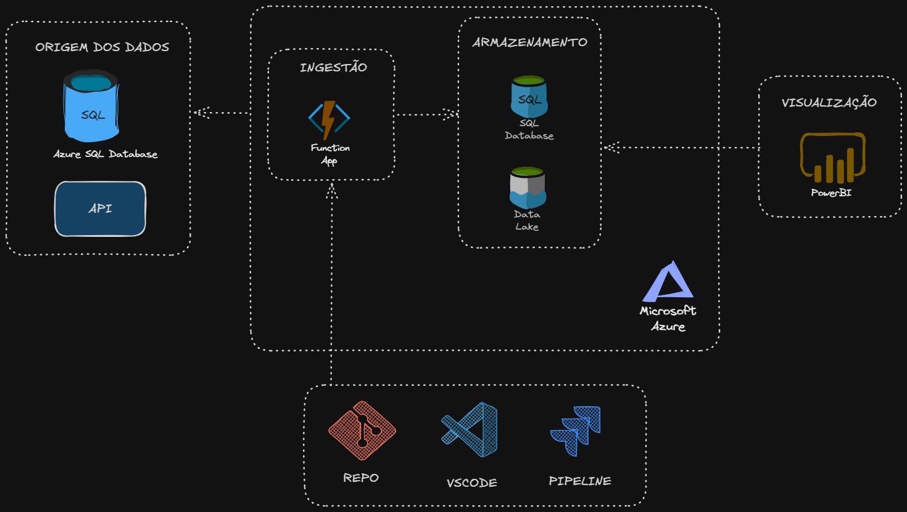

Alunos:
- André Ricardo Maier
- Pedro Paulo Hecht
- Vitor de Castro Alves

data: 
23/10/2026

## Desenho do projeto

## Persistência da Function App

As funções leem as tabelas do banco de origem e fazem upsert no banco Azure SQL
de destino, no schema `itsm`. Os arquivos não são mais gravados no Data Lake.

Configure estas Application Settings na Function App:

- `TARGET_HOST`: `sv-taprc-vitor-alves.database.windows.net,1433`.
- `TARGET_DATABASE`: `db-taprc`.
- `TARGET_USER`: usuário do banco destino.
- `TARGET_PASSWORD`: senha do banco destino.
- `HOST`, `DATABASE`, `USER` e `PASSWORD`: permanecem as configurações já
  existentes para o banco de origem.

A conexão usa ODBC Driver 18, `Encrypt=yes`, `TrustServerCertificate=no`,
`Connection Timeout=30` e `Authentication=ActiveDirectoryPassword`.

As credenciais devem ser substituídas somente nas configurações da Function App,
nunca neste repositório. Para desenvolvimento local, use `local.settings.json`
sem versionar credenciais.

O upsert usa a primeira coluna de cada tabela como chave e preserva os valores
das colunas identity, permitindo executar os timers novamente sem duplicar
registros. As tabelas e o schema `itsm` precisam existir no banco de destino.
